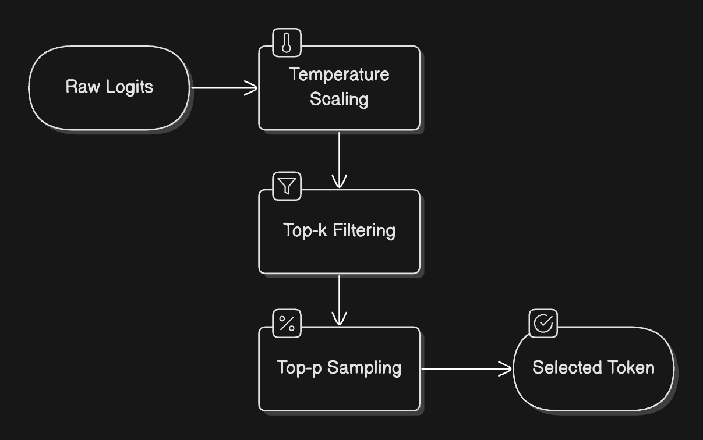
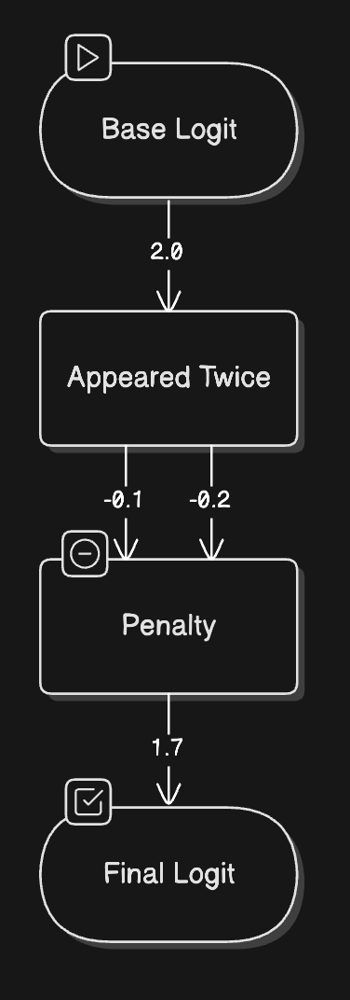
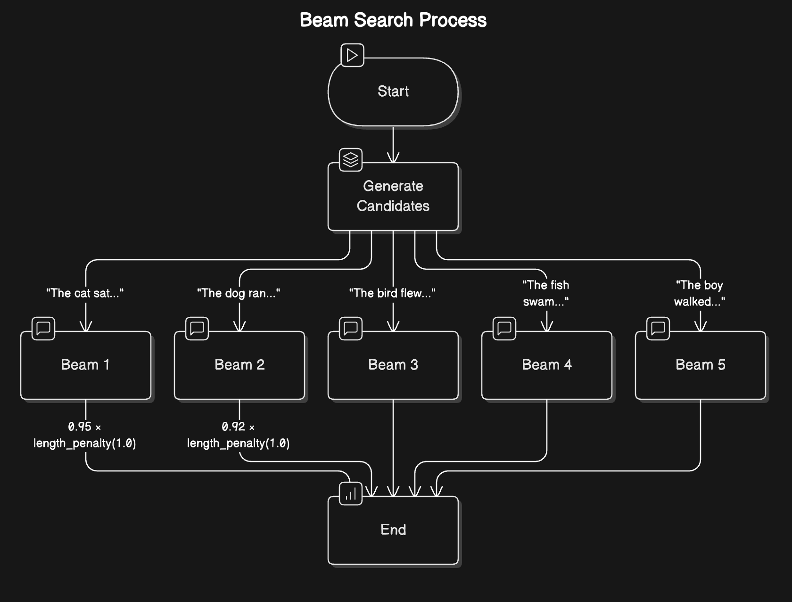

# Exploration approfondie de l'inférence pour la génération de texte avec les LLM
> Source : [Hugging Face LLM Course - Deep dive into Text Generation Inference with LLMs](https://huggingface.co/learn/llm-course/en/chapter1/8)

## Comprendre les bases

L'inférence est le processus qui consiste à utiliser un LLM entraîné pour générer un texte semblable à celui d'un humain à partir d'un prompt d'entrée. Les modèles de langage utilisent les connaissances acquises pendant l'entraînement pour formuler des réponses un mot à la fois. Le modèle exploite les probabilités apprises à travers des milliards de paramètres pour prédire et générer le prochain token d'une séquence. C'est cette génération séquentielle qui permet aux LLM de produire un texte cohérent et pertinent par rapport au contexte.

## Le rôle de l'attention

Le mécanisme d'attention est ce qui donne aux LLM leur capacité à comprendre le contexte et à générer des réponses cohérentes. Lorsqu'il s'agit de prédire le mot suivant, tous les mots d'une phrase n'ont pas la même importance. Par exemple, dans la phrase *« La capitale de la France est… »*, les mots « France » et « capitale » sont essentiels pour déterminer que « Paris » doit suivre. Cette capacité à se concentrer sur les informations pertinentes est l'attention.


Le principe de base de l'entraînement des LLM (prédire le prochain token) soit resté globalement le même depuis BERT et GPT-2, des progrès considérables ont été réalisés dans la mise à l'échelle des réseaux neuronaux et dans le fonctionnement du mécanisme d'attention sur des séquences de plus en plus longues, à des coûts de plus en plus faibles.

### Longueur du contexte et portée de l'attention

La longueur du contexte correspond au nombre maximal de tokens que le LLM peut traiter en une seule fois. Soit la taille de la mémoire de travail du modèle.

Ces capacités sont limitées par plusieurs facteurs pratiques :

- L'architecture et la taille du modèle
- Les ressources de calcul disponibles
- La complexité de l'entrée et de la sortie souhaitée

Dans un monde idéal, on pourrait fournir un contexte illimité au modèle, mais les contraintes matérielles et les coûts de calcul rendent cela impossible. Donc différents modèles sont conçus avec différentes longueurs de contexte, afin d'équilibrer capacités et efficacité.

### L'art de formuler des prompts

Lorsque nous transmettons des informations aux LLM, nous structurons notre entrée de manière à orienter la génération du LLM vers la sortie souhaitée. C'est le *prompting*.

Comprendre comment les LLM traitent l'information nous aide à concevoir de meilleurs prompts. Puisque la tâche principale du modèle consiste à prédire le prochain token en analysant l'importance de chaque token d'entrée, la formulation de la séquence d'entrée devient cruciale.

## Le processus d'inférence en deux phases

Examinons en détail comment les LLM génèrent réellement du texte. Le processus peut être décomposé en deux grandes phases : *prefill* et *decode*. Ces phases fonctionnent ensemble comme une chaîne de montage.

### La phase de prefill

La phase de *prefill* ressemble à l'étape de préparation en cuisine : c'est là que tous les ingrédients initiaux sont traités et préparés. Cette phase comprend trois étapes clés :

1. **Tokenisation** : convertir le texte d'entrée en tokens.
2. **Conversion en embeddings** : transformer ces tokens en représentations numériques qui capturent leur signification.
3. **Traitement initial** : faire passer ces embeddings dans les réseaux neuronaux du modèle afin de construire une compréhension riche du contexte.

Cette phase demande beaucoup de calculs, car elle doit traiter tous les tokens d'entrée en une seule fois. Imaginez que vous lisiez et compreniez un paragraphe entier avant de commencer à rédiger une réponse.

### La phase de decode

Une fois que la phase de *prefill* a traité l'entrée, nous passons à la phase de *decode* : c'est là que la génération du texte proprement dite se produit. Le modèle génère un token à la fois dans un processus autorégressif (où chaque nouveau token dépend de tous les tokens précédents).

La phase de *decode* comprend plusieurs étapes clés qui se produisent pour chaque nouveau token :

1. **Calcul de l'attention** : revenir sur tous les tokens précédents pour comprendre le contexte.
2. **Calcul des probabilités** : déterminer la probabilité de chaque prochain token possible.
3. **Sélection du token** : choisir le prochain token à partir de ces probabilités.
4. **Vérification de la poursuite** : décider s'il faut poursuivre ou arrêter la génération.

Cette phase est gourmande en mémoire, car le modèle doit garder la trace de tous les tokens générés précédemment et de leurs relations.

## Stratégies d'échantillonnage

Explorons les différentes façons de contrôler ce processus de génération. Tout comme un écrivain peut choisir d'être plus créatif ou plus précis, nous pouvons ajuster la manière dont le modèle sélectionne ses tokens.

### Comprendre la sélection des tokens : des probabilités au choix des tokens

Lorsque le modèle doit choisir le prochain token, il commence avec des probabilités brutes (*logits*) pour chaque mot de son vocabulaire. Mais comment transformer ces probabilités en choix effectifs ? Décomposons le processus :



1. **Logits bruts** : intuitions initiales du modèle à propos de chaque prochain mot possible.
2. **Contrôle de la température** : comme un réglage de créativité - des valeurs plus élevées (supérieures à 1,0) rendent les choix plus aléatoires et créatifs, tandis que des valeurs plus faibles (inférieures à 1,0) les rendent plus ciblés et déterministes.
3. **Échantillonnage top-p (*nucleus sampling*)** : au lieu de considérer tous les mots possibles, nous ne regardons que les plus probables, dont la somme atteint le seuil de probabilité choisi (par exemple, les 90 % les plus probables cumulés).
4. **Filtrage top-k** : une autre approche dans laquelle nous ne considérons que les `k` prochains mots les plus probables.

### Gérer la répétition : préserver la variété du texte généré

L'un des problèmes courants des LLM est leur tendance à se répéter. Pour y remédier, nous utilisons deux types de pénalités :

1. **Pénalité de présence (*presence penalty*)** : une pénalité fixe appliquée à tout token déjà apparu, quel que soit son nombre d'occurrences. Elle permet d'éviter que le modèle réutilise les mêmes mots.
2. **Pénalité de fréquence (*frequency penalty*)** : une pénalité progressive qui augmente en fonction du nombre de fois où un token a été utilisé. Plus un mot apparaît, moins il est susceptible d'être choisi à nouveau.



Ces pénalités sont appliquées tôt dans le processus de sélection des tokens, en ajustant les probabilités brutes avant l'application des autres stratégies d'échantillonnage, encourageant le modèle à explorer un vocabulaire nouveau.

### Contrôler la longueur de la génération : fixer des limites

On a besoin de moyens pour contrôler la quantité de texte que génère un LLM. C'est essentiel pour les applications pratiques, qu'il s'agisse de produire une réponse de la longueur d'un tweet ou un article de blog complet.

Nous pouvons contrôler la longueur de la génération de plusieurs manières :

1. **Limites de tokens** : définir un nombre minimal et maximal de tokens.
2. **Séquences d'arrêt (*stop sequences*)** : définir des motifs précis qui signalent la fin de la génération.
3. **Détection de fin de séquence** : laisser le modèle conclure naturellement sa réponse.

Par exemple, si nous voulons générer un seul paragraphe, nous pouvons définir un maximum de 100 tokens et utiliser `"\n\n"` comme séquence d'arrêt. Cela garantit que notre sortie reste ciblée et d'une longueur adaptée à son objectif.

### Recherche par faisceau (*beam search*) : anticiper pour une meilleure cohérence

La recherche par faisceau adopte une approche plus globale. Au lieu de s'engager sur un seul choix à chaque étape, elle explore simultanément plusieurs chemins possibles.



Voici le fonctionnement :

1. À chaque étape, conserver plusieurs séquences candidates (généralement de 5 à 10).
2. Pour chaque candidate, calculer les probabilités du prochain token.
3. Ne conserver que les combinaisons les plus prometteuses entre les séquences et les prochains tokens.
4. Poursuivre ce processus jusqu'à atteindre la longueur souhaitée ou une condition d'arrêt.
5. Sélectionner la séquence ayant la probabilité globale la plus élevée.

Cette approche produit souvent un texte plus cohérent et grammaticalement correct, même si elle nécessite davantage de ressources de calcul que les méthodes plus simples.

## Défis pratiques et optimisation

### Principales métriques de performance

Quatre métriques essentielles orienteront le choix d'implémentation :

1. **Temps avant le premier token (*Time to First Token*, TTFT)** : à quelle vitesse on obtient le début de la réponse ? C'est essentiel pour l'expérience utilisateur et principalement influencé par la phase de *prefill*.
2. **Temps par token de sortie (*Time Per Output Token*, TPOT)** : à quelle vitesse on génère les tokens suivants ? Cela détermine la vitesse globale de génération.
3. **Débit (*throughput*)** : combien de requêtes peut-on traiter simultanément ? Cela influe sur la capacité de passage à l'échelle et l'efficacité des coûts.
4. **Utilisation de la VRAM** : de quelle quantité de mémoire GPU avons-nous besoin ? Cela devient souvent la principale contrainte dans les applications réelles.

### Le défi de la longueur du contexte

L'un des défis les plus importants de l'inférence avec les LLM est la gestion efficace de la longueur du contexte. Des contextes plus longs fournissent davantage d'informations, mais entraînent des coûts considérables :

- **Utilisation de la mémoire** : augmente de façon quadratique avec la longueur du contexte.
- **Vitesse de traitement** : diminue de façon linéaire avec des contextes plus longs.
- **Allocation des ressources** : nécessite un équilibre soigneux de l'utilisation de la VRAM.

Des modèles récents comme [Qwen2.5-1M](https://huggingface.co/Qwen/Qwen2.5-14B-Instruct-1M) offrent d'impressionnantes fenêtres de contexte d'un million de tokens, mais au prix de temps d'inférence considérablement plus longs. L'essentiel est de trouver le bon équilibre pour nos cas d'utilisation particulier.

```text
Texte d'entrée (brut)  →  Entrée tokenisée
                                  ↓
                   ┌─────────────────────────────┐
                   │      Fenêtre de contexte    │
                   │   (par ex. 4 000 tokens)    │
                   │         ▮ ▮ ▮ ▮          │
                   └─────────────────────────────┘
                            ↙           ↘
             Utilisation mémoire     Temps de traitement
                ∝ longueur²            ∝ longueur
```

### L'optimisation par cache KV

L'une des optimisations les plus puissantes est la mise en cache KV (*Key-Value*, clé-valeur). Cette technique améliore considérablement la vitesse d'inférence en stockant et en réutilisant les calculs intermédiaires. Cette optimisation :

- Réduit les calculs répétés.
- Améliore la vitesse de génération.
- Rend possible, en pratique, la génération avec de longs contextes.

La contrepartie est une utilisation supplémentaire de mémoire, mais les gains de performance l'emportent généralement largement sur ce coût.

## Conclusion

Comprendre l'inférence avec les LLM est essentiel pour déployer et optimiser efficacement ces modèles puissants. Nous avons couvert les composants clés :

- Le rôle fondamental de l'attention et du contexte.
- Le processus d'inférence en deux phases.
- Les différentes stratégies d'échantillonnage permettant de contrôler la génération.
- Les défis pratiques et les optimisations.
